# Laporan Akhir Fase 2 & 2.1: Arsitektur Basis Data, Audit Keamanan & Kompatibilitas MySQL
## PPDB Minsatama — MIN 1 Kota Madiun

Tanggal Pelaksanaan: 15 November 2026  
Status: **SELESAI & TERVERIFIKASI (39 Tests Passed, 2 Skipped Pending MySQL Daemon, Pint Passed)**

---

## 1. Physical Entity Relationship Diagram (ERD)

```mermaid
erDiagram
    users ||--o| applicants : "1 to 1 (user_id)"
    users ||--o{ user_otp_tokens : "1 to N (user_id)"
    users ||--o{ registration_logs : "1 to N (user_id)"
    users ||--o{ registration_pdf_versions : "1 to N (generated_by)"
    users ||--o{ registration_document_revisions : "1 to N (uploaded_by)"

    applicants ||--|| applicant_addresses : "1 to 1 (applicant_id)"
    applicants ||--o{ applicant_guardians : "1 to N (max 3: FATHER, MOTHER, GUARDIAN)"
    applicants ||--|| applicant_educations : "1 to 1 (applicant_id)"
    applicants ||--o{ registrations : "1 to N (1 per periode)"

    admission_periods ||--o{ admission_period_programs : "1 to N (admission_period_id)"
    admission_periods ||--o{ document_requirements : "1 to N (admission_period_id)"
    admission_periods ||--o{ registrations : "1 to N (admission_period_id)"

    programs ||--o{ admission_period_programs : "1 to N (program_id)"
    programs ||--o{ document_requirements : "0..1 to N (program_id nullable)"

    admission_period_programs ||--o{ registrations : "1 to N (admission_period_program_id)"

    registrations ||--o{ registration_documents : "1 to N (registration_id)"
    registrations ||--|| registration_consents : "1 to 1 (registration_id)"
    registrations ||--o{ registration_logs : "1 to N (registration_id)"
    registrations ||--o{ registration_pdf_versions : "1 to N (registration_id)"

    document_requirements ||--o{ registration_documents : "1 to N (document_requirement_id)"
    registration_documents ||--o{ registration_document_revisions : "1 to N (registration_document_id)"

    users {
        bigint id PK
        string nik_lookup_hash UK "HMAC-SHA256, nullable for admin"
        text nik_encrypted "AES-256-CBC, nullable for admin"
        string name
        string email UK "nullable for applicant"
        string phone "non-unique, nullable"
        string account_type "applicant | admin"
        string account_status "pending_activation | active | suspended"
        timestamp phone_verified_at
        timestamp email_verified_at
        string password
    }

    applicants {
        bigint id PK
        bigint user_id FK,UK "One-to-one with user"
        string full_name
        string gender "L | P"
        string birth_place
        date birth_date
        string nisn "10 digits, nullable"
        smallint child_order
        smallint siblings_count
    }

    applicant_addresses {
        bigint id PK
        bigint applicant_id FK,UK
        text address_line
        string rt
        string rw
        string kelurahan
        string kecamatan
        string city
        string province
        string postal_code
        decimal distance_to_school_km
    }

    applicant_guardians {
        bigint id PK
        bigint applicant_id FK
        string relationship_type "FATHER | MOTHER | GUARDIAN"
        string name
        string nik
        string education
        string occupation
        string monthly_income
        string phone
        boolean is_alive
    }

    applicant_educations {
        bigint id PK
        bigint applicant_id FK,UK
        string education_level "ra | tk | paud | other | none"
        string school_name
        string npsn
        string city
    }

    admission_periods {
        bigint id PK
        string name
        string academic_year "e.g. 2026/2027"
        datetime start_date
        datetime end_date
        date age_reference_date "e.g. 2026-07-01"
        string status "draft | active | closed | archived"
        boolean is_active
        text description
    }

    programs {
        bigint id PK
        string code UK "UNGGULAN | REGULER"
        string name
        text description
        boolean is_active
    }

    admission_period_programs {
        bigint id PK
        bigint admission_period_id FK
        bigint program_id FK
        boolean is_active
        text notes
    }

    registrations {
        bigint id PK
        string registration_number UK "Generated upon submission"
        bigint applicant_id FK
        bigint admission_period_id FK
        bigint admission_period_program_id FK
        string status "DRAFT | SUBMITTED"
        datetime submitted_at
        int data_revision "Default 1"
        text notes
    }

    document_requirements {
        bigint id PK
        bigint admission_period_id FK
        bigint program_id FK "nullable for global period requirement"
        string code "e.g. KK, AKTA, FOTO"
        string name
        boolean is_required
        string allowed_mimes
        int max_size_kb
        smallint sort_order
    }

    registration_documents {
        bigint id PK
        bigint registration_id FK
        bigint document_requirement_id FK
        string file_path "Private storage"
        string original_name
        string mime_type
        bigint file_size_bytes
        string file_hash "SHA-256"
        datetime uploaded_at
    }

    registration_document_revisions {
        bigint id PK
        bigint registration_document_id FK
        int revision_number
        string file_path
        string original_name
        string mime_type
        bigint file_size_bytes
        string file_hash "SHA-256"
        bigint uploaded_by FK
        datetime replaced_at
        string reason
    }

    registration_consents {
        bigint id PK
        bigint registration_id FK,UK
        text statement_text
        boolean is_agreed
        datetime agreed_at
        string ip_address
        text user_agent
    }

    registration_logs {
        bigint id PK
        bigint registration_id FK
        bigint user_id FK
        string action
        int from_revision
        int to_revision
        json changes "Redacted, no NIK/password"
        string ip_address
        text user_agent
        timestamp created_at
    }

    registration_pdf_versions {
        bigint id PK
        bigint registration_id FK
        string document_type "draft | final"
        int version_number
        int data_revision
        string file_path
        string file_hash "SHA-256"
        bigint generated_by FK
        datetime generated_at
    }

    user_otp_tokens {
        bigint id PK
        bigint user_id FK
        string phone
        string purpose "activation | password_reset"
        string otp_hash "Hash::make, never plaintext"
        smallint attempts
        smallint max_attempts
        datetime expires_at
        datetime verified_at
    }
```



---

## 2. Hasil Audit Keamanan NIK & OTP (Security Audit Findings)

Berdasarkan audit mendalam pada Fase 2.1:

### A. Audit Keamanan NIK (`app/Support/NikManager.php` & `config/ppdb.php`)
1. **Peniadaan Hardcoded Fallback**:
   - Nilai fallback hardcoded `'default-ppdb-minsatama-hmac-key-change-in-production'` pada `config/ppdb.php` telah **dihapus**.
   - `NikManager::hash()` kini memvalidasi keberadaan `NIK_HMAC_KEY` secara eksplisit dan melemparkan `\RuntimeException` jika belum ditentukan di `.env`.
2. **Pemisahan Kunci Enkripsi dan HMAC**:
   - `NikManager::hash()` memeriksa bahwa `NIK_HMAC_KEY` **tidak boleh identik** dengan `APP_KEY`. Hal ini mencegah kompromi kunci tunggal antar fungsi hash lookup dan reversibel cipher AES-256-CBC.
3. **Validasi Panjang Eksak 16 Digit**:
   - `NikManager::normalize()` membersihkan karakter non-numerik dan memverifikasi panjang tepat 16 digit. Kurang atau lebih dari 16 digit melemparkan `\InvalidArgumentException`.
4. **Pencegahan Kebocoran Plaintext NIK**:
   - Model `User` menyembunyikan (`$hidden`) kolom `nik_encrypted` dan `nik_lookup_hash` dari `toArray()` dan `toJson()`.
   - Diuji dan diverifikasi oleh `test_user_model_never_exposes_nik_in_serialization()`.
5. **Masking Antarmuka**:
   - `NikManager::mask()` memformat NIK menjadi `3573********0001` (4 digit pertama dan 4 digit terakhir terlihat, 8 digit tengah disensor).

### B. Audit Skema & Token OTP (`user_otp_tokens`)
1. **Hash Satu Arah**: Kolom `otp_hash` (VARCHAR 255) menyimpan representasi `Hash::make()` dari kode 6 digit. Plaintext kode OTP **tidak pernah disimpan** di basis data.
2. **Pemisahan Tujuan (Purpose)**: Divalidasi oleh Enum `OtpPurpose` (`activation`, `password_reset`).
3. **Mekanisme Kedaluwarsa & Pembatasan Percobaan**:
   - Method `verify($plainOtp)` otomatis menaikkan `attempts`.
   - Token ditolak jika `isExpired()`, `isExhausted()`, atau `isVerified()`.
4. **Pencegahan Penggunaan Berulang**: `verified_at` diisi timestamp saat verifikasi pertama berhasil.

### C. Audit Spatie Laravel Permission
1. **Guard Binding**: Seluruh peran (`superadmin`, `admin_ppdb`) dan hak akses terikat pada guard default `web`.
2. **Isolasi Akun Siswa**: Akun bertipe `AccountType::APPLICANT` tidak memiliki izin administratif apa pun (`test_applicant_accounts_have_no_administrative_roles`).
3. **Idempotensi Seeder**: `RoleAndPermissionSeeder` dan `SuperAdminSeeder` dapat dijalankan berulang kali tanpa menghasilkan error atau duplikasi data.

---

## 3. Matriks Verifikasi Batasan Fisik Basis Data (Physical Database Constraints)

| Batasan / Aturan Bisnis | Tabel & Kolom Terkait | Jenis Constraint | Status Verifikasi |
|---|---|---|---|
| **Unique NIK Lookup Hash** | `users(nik_lookup_hash)` | UNIQUE INDEX | **LULUS** (`test_rule_1_one_nik_cannot_be_duplicated`) |
| **Unique Applicant Profile** | `applicants(user_id)` | UNIQUE FK | **LULUS** (`test_rule_3_each_applicant_has_only_one_profile`) |
| **Unique Siswa per Periode** | `registrations(applicant_id, admission_period_id)` | UNIQUE INDEX | **LULUS** (`test_rule_5_one_applicant_cannot_register_twice_in_the_same_period`) |
| **Unique Registration Number** | `registrations(registration_number)` | UNIQUE INDEX (nullable) | **LULUS** (`test_rule_12_nullable_registration_numbers_supported_for_draft`) |
| **Unique Program per Periode** | `admission_period_programs(admission_period_id, program_id)` | UNIQUE INDEX | **LULUS** (`test_rule_7_program_cannot_be_duplicated_in_the_same_period`) |
| **Unique Relasi Wali per Siswa** | `applicant_guardians(applicant_id, relationship_type)` | UNIQUE INDEX | **LULUS** (`test_rule_8_father_and_mother_relationship_types_cannot_be_duplicated`) |
| **Unique Dokumen per Syarat** | `registration_documents(registration_id, document_requirement_id)` | UNIQUE INDEX | **LULUS** (`test_rule_9_multiple_document_revisions_are_supported`) |
| **Unique Versi PDF per Tipe** | `registration_pdf_versions(registration_id, document_type, version_number)` | UNIQUE INDEX | **LULUS** (`test_rule_10_pdf_version_numbers_cannot_be_duplicated_for_same_type`) |
| **Nullable Draf Reg Number** | `registrations(registration_number)` | NULLABLE | **LULUS** (Draf tidak memerlukan nomor registrasi hingga resmi submit) |
| **Non-Unique No. Telepon** | `users(phone)` | Standard Column (No UK) | **LULUS** (`test_rule_2_different_accounts_may_reuse_the_same_phone_number`) |

---

## 4. Status Verifikasi Lingkungan MySQL (MySQL Verification Status)

- **Ekstensi PHP CLI**: `pdo_mysql` versi ZTS x64 telah **AKTIF** pada PHP 8.3.31.
- **Konfigurasi Koneksi Uji MySQL**: Dibuat koneksi terisolasi `'mysql_test'` pada `config/database.php` mengarah ke database sementara:
  ```php
  'mysql_test' => [
      'driver' => 'mysql',
      'host' => env('DB_TEST_HOST', '127.0.0.1'),
      'port' => env('DB_TEST_PORT', '3306'),
      'database' => env('DB_TEST_DATABASE', 'ppdb_minsatama_test'),
      'username' => env('DB_TEST_USERNAME', 'root'),
      'password' => env('DB_TEST_PASSWORD', ''),
      'engine' => 'InnoDB',
      'strict' => true,
  ]
  ```
- **Pemeriksaan Port Database (3306, 3307, 3308, 33060)**: Seluruh port database pada mesin lokal Windows saat ini berstatus **CLOSED (Offline)**. Tidak ditemukan service daemon MySQL/MariaDB yang sedang berjalan.
- **Status Kepatuhan Aturan**:
  - Sesuai instruksi Section 1 & 7, **kami TIDAK mengklaim bahwa migrasi MySQL telah lulus secara aktual**.
  - Pengujian kompatibilitas MySQL pada `tests/Feature/Database/MySqlSchemaCompatibilityTest.php` dirancang otomatis melewati pengujian (`markTestSkipped`) dengan pesan status: **`PENDING (MySQL daemon offline pada 127.0.0.1:3306)`**.
  - Seluruh 16 berkas migrasi dirancang 100% menggunakan arsitektur MySQL InnoDB (foreign keys, `onDelete('cascade')`, `onDelete('restrict')`, unsigned big integers, compound indexes).

### Langkah Manual untuk Menjalankan MySQL Lokal (Jika Diperlukan):
1. **Menggunakan Laragon / XAMPP**:
   - Jika menggunakan Laragon: Buka Laragon -> Klik **Start All** (memulai MySQL pada port 3306).
   - Jika menggunakan XAMPP: Buka XAMPP Control Panel -> Klik **Start** pada baris MySQL.
2. **Menggunakan Docker (Alternatif Cepat)**:
   ```sh
   docker run --name minsatama-mysql -e MYSQL_ROOT_PASSWORD= -e MYSQL_ALLOW_EMPTY_PASSWORD=yes -e MYSQL_DATABASE=ppdb_minsatama -p 3306:3306 -d mysql:8.4
   ```
3. **Eksekusi Pengujian MySQL Setelah Server Aktif**:
   ```sh
   php artisan test --filter=MySqlSchemaCompatibilityTest
   ```

---

## 5. Ringkasan Eksekusi Pengujian Otomatis

```
PASS  Tests\Unit\ExampleTest (1 test)
PASS  Tests\Unit\SecurityAndOtpTest (13 tests)
PASS  Tests\Feature\ExampleTest (1 test)
PASS  Tests\Feature\FoundationTest (3 tests)
PASS  Tests\Feature\Database\DatabaseSchemaAndRulesTest (14 tests)
PASS  Tests\Feature\Database\SpatiePermissionSecurityTest (7 tests)
S     Tests\Feature\Database\MySqlSchemaCompatibilityTest (2 skipped: MySQL server offline)

Tests:    39 passed, 2 skipped (106 assertions)
Duration: 5.27s
Pint:     PASSED (0 errors)
```

---

## 6. Berkas yang Dibuat / Dimodifikasi pada Fase 2.1

1. `config/ppdb.php` — Menghapus hardcoded fallback `nik_hmac_key`.
2. `app/Support/NikManager.php` — Memvalidasi ketiadaan kunci HMAC, mencegah penggunaan `APP_KEY` sebagai kunci HMAC, dan validasi eksak 16 digit.
3. `phpunit.xml` — Menambahkan environment `NIK_HMAC_KEY` khusus lingkungan pengujian.
4. `config/database.php` — Menambahkan konfigurasi koneksi uji terisolasi `'mysql_test'` (InnoDB, target `ppdb_minsatama_test`).
5. `tests/Unit/SecurityAndOtpTest.php` — Menambahkan pengujian missing secret, identical APP_KEY rejection, length validation, dan model serialization privacy.
6. `tests/Feature/Database/SpatiePermissionSecurityTest.php` — Pengujian komprehensif role guard `web`, HasRoles trait, isolasi role applicant, dan idempotensi seeder.
7. `tests/Feature/Database/MySqlSchemaCompatibilityTest.php` — Rangkaian pengujian migrasi & InnoDB engine khusus MySQL pada database sekali pakai `ppdb_minsatama_test`.
8. `docs/PHASE-2-DATABASE-REPORT.md` — Pembaruan berkas dokumentasi ini.

---

## 7. Rekomendasi Menuju Fase 3 (Authentication)

Dengan tuntasnya arsitektur basis data, model Eloquent, pengujian integritas batasan relasional, dan audit keamanan data NIK/OTP:
- Fondasi data pendaftar, orang tua, alamat, riwayat sekolah, syarat dokumen, registrasi, audit log, persetujuan, dan token OTP telah siap 100%.
- Kita siap melangkah ke **Fase 3: Authentication** (Registrasi Akun NIK, Alur OTP WhatsApp, Login NIK + Password, Login Admin Email + Password, dan Pemulihan Akun).
