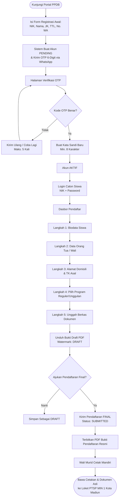
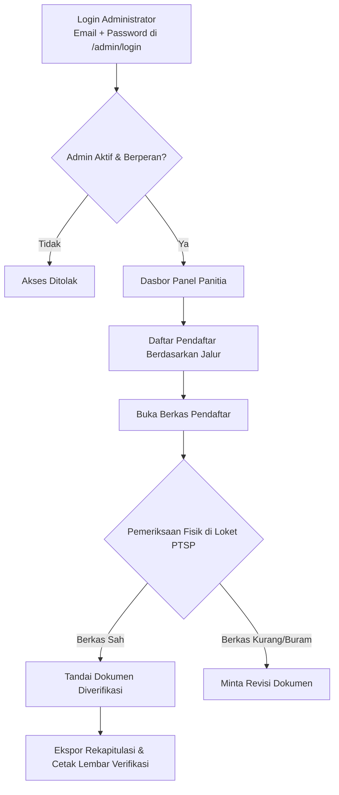
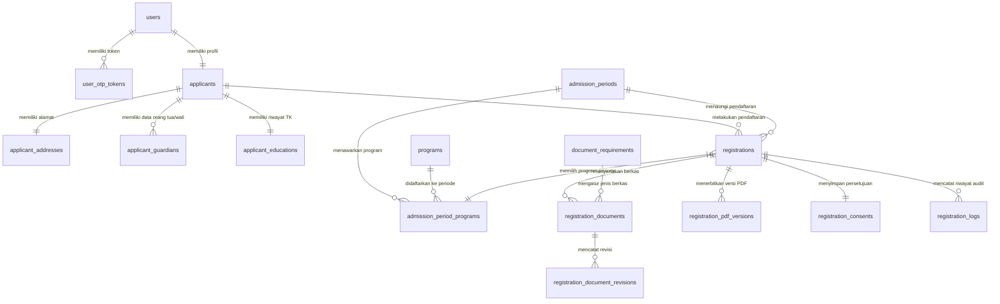

# PROJECT BLUEPRINT — PPDB MINSATAMA
## Sistem Informasi Penerimaan Peserta Didik Baru MIN 1 Kota Madiun

---

## 1. IKHTISAR PROYEK (PROJECT OVERVIEW)

**PPDB Minsatama** adalah sistem informasi pendaftaran peserta didik baru berbasis web yang dikembangkan khusus untuk Madrasah Ibtidaiyah Negeri (MIN) 1 Kota Madiun (Kementerian Agama Republik Indonesia). Sistem ini dirancang untuk memodernisasi proses pendaftaran calon peserta didik baru kelas 1 MI menjadi transparan, aman, akuntabel, mudah diakses oleh wali murid dari berbagai perangkat, serta efisien bagi panitia madrasah.

Aplikasi ini beroperasi dalam zona waktu **Asia/Jakarta** (`WIB`) dan menggunakan **Bahasa Indonesia** sebagai bahasa utama antarmuka pengguna.

---

## 2. TUJUAN BISNIS (BUSINESS OBJECTIVES)

1. **Efisiensi Pendaftaran Mandiri**: Memfasilitasi orang tua/wali murid mendaftarkan calon siswa secara mandiri kapan saja selama periode pendaftaran aktif tanpa harus mengantre panjang untuk pengisian formulir fisik di madrasah.
2. **Integritas & Akurasi Data**: Menjamin standarisasi data calon siswa, nomor identitas kependudukan (NIK), riwayat pendidikan anak usia dini (TK/RA), data ayah dan ibu kandung, serta data wali.
3. **Penyimpanan Dokumen Digital**: Mendukung pengunggahan dokumen persyaratan legal (Kartu Keluarga, Akta Kelahiran, Surat Keterangan Lulus/Surat Keterangan TK, Pas Foto, dan Piagam Prestasi) secara privat dan terstruktur.
4. **Penerbitan Bukti Sah (PDF Generator)**: Menghasilkan lembar bukti pendaftaran resmi berformat PDF yang dilengkapi kode registrasi unik, penanda versi, dan stempel status untuk dibawa pendaftar saat verifikasi fisik dokumen asli di loket PTSP madrasah.
5. **Transparansi & Pengawasan Panitia**: Memberikan panel terpadu bagi administrator dan panitia PPDB untuk memantau arus pendaftaran, memverifikasi kesesuaian berkas secara berkala, dan mencetak laporan rekapitulasi.

---

## 3. BATASAN RUANG LINGKUP (SCOPE BOUNDARIES)

Untuk menjaga integritas dan ketepatan fungsi sistem, batas ruang lingkup didefinisikan secara tegas:

```
[Ruang Lingkup Sistem PPDB Minsatama]
========================================================================================
(DALAM RUANG LINGKUP / IN-SCOPE)
✓ Pendaftaran akun calon siswa berbasis NIK 16 digit.
✓ Verifikasi kepemilikan nomor WhatsApp melalui kode OTP 6 digit.
✓ Pengisian dan pembaruan biodata siswa, alamat, orang tua (ayah & ibu), dan pendidikan TK.
✓ Pemilihan jalur program pendidikan (Reguler atau Unggulan).
✓ Pengunggahan dan penggantian dokumen persyaratan berkas pendaftaran.
✓ Penyimpanan status formulir pendaftaran: DRAFT dan SUBMITTED.
✓ Pembuatan dokumen PDF Bukti Pendaftaran Sementara (Watermark DRAFT) dan Final.
✓ Manajemen verifikasi berkas dan pelaporan statistik oleh administrator.
========================================================================================
(DI LUAR RUANG LINGKUP / OUT-OF-SCOPE)
✗ Proses seleksi penerimaan siswa (akademik, pemetaan bakat/minat, atau tes baca Al-Qur'an).
✗ Perankingan calon siswa berdasarkan usia, nilai, atau kriteria lain.
✗ Penetapan status kelulusan/diterima atau penolakan siswa oleh sistem.
✗ Pengumuman hasil penerimaan akhir dan alur daftar ulang (re-registration).
✗ Pembatasan kuota pendaftar (sistem tidak menolak pendaftaran atas dasar pemenuhan kuota).
========================================================================================
```

> [!IMPORTANT]
> Sistem PPDB Minsatama **berakhir** saat wali murid menyelesaikan pengisian data pendaftaran, mengunduh bukti PDF final, dan menyerahkan berkas fisik bersama dokumen asli ke loket Pelayanan Terpadu Satu Pintu (PTSP) MIN 1 Kota Madiun. Proses seleksi dan keputusan akhir dilakukan secara terpisah oleh madrasah di luar sistem ini.

---

## 4. STAKEHOLDER & PENGGUNA SISTEM (ACTORS)

| Aktor | Peran & Hak Akses | Metode Autentikasi |
|---|---|---|
| **Calon Siswa / Orang Tua / Wali** | Mendaftarkan akun, mengisi formulir pendaftaran, mengunggah dokumen persyaratan, menyimpan draft, mengirim formulir final, dan mencetak bukti PDF. | NIK 16 digit + Kata Sandi (setelah verifikasi OTP WhatsApp) |
| **Panitia PPDB (`admin_ppdb`)** | Memeriksa berkas pendaftar, memvalidasi kelengkapan berkas fisik saat penyerahan di PTSP, meminta revisi dokumen jika buram/salah, mencetak rekapitulasi pendaftar. | Email Madrasah + Kata Sandi |
| **Super Administrator (`superadmin`)** | Mengatur periode pendaftaran PPDB, kuota indikatif, konfigurasi dokumen persyaratan, manajemen akun panitia, dan audit log keamanan. | Email Madrasah + Kata Sandi |

---

## 5. TUMPANG TINDIH TEKNOLOGI (TECHNOLOGY STACK)

- **Backend Framework**: Laravel 13.x (PHP 8.3+).
- **Arsitektur Perangkat Lunak**: Monolith MVC dengan Service/Action Pattern, Form Requests, Enums, dan Model Observers.
- **Basis Data**: MySQL (InnoDB, UTF8MB4) sebagai target produksi, SQLite in-memory untuk pengujian cepat.
- **Frontend**: Blade Templating Engine + Tailwind CSS v4 + Vanilla JS interaktif.
- **Manajemen Hak Akses & Peran**: Spatie Laravel Permission 8.5+ (terpasang pada guard `web`).
- **Kriptografi & Keamanan**:
  - Laravel Crypt (AES-256-CBC) untuk enkripsi NIK calon siswa.
  - HMAC-SHA256 dengan kunci mandiri `NIK_HMAC_KEY` untuk pencarian indeks deterministik NIK.
  - HMAC-SHA256 dengan kunci mandiri `OTP_HMAC_KEY` dan *context binding* untuk token OTP.
- **Penyimpanan Berkas**: Private Disk Storage (dokumen pendaftaran tersimpan di luar direktori publik web).
- **Mesin PDF**: DomPDF / Snappy (terjadwal pada Fase 7).

---

## 6. PRINSIP ARSITEKTUR & DESAIN

1. **Satu Tabel `users` & Satu Guard `web`**: Menghindari kompleksitas dan kerentanan multi-guard; pembedaan peran ditegakkan melalui kolom `account_type` dan middleware otorisasi.
2. **Pemisahan Logika Bisnis (*Thin Controllers, Dedicated Actions*)**: Kontroler hanya bertanggung jawab menerima request, mendelegasikan eksekusi ke Action/Service, dan mengembalikan response atau view.
3. **Data Immutability & Versioning**: Riwayat revisi dokumen dan histori berkas PDF disimpan berkesinambungan; tidak ada penimpaan destruktif pada data audit.
4. **Pencegahan Enumerasi Akun**: Seluruh pesan kesalahan login dan lupa kata sandi dirancang generik sehingga penyerang tidak dapat menebak keberadaan NIK tertentu di sistem.
5. **Aksesibilitas & Standar Madrasah**: Seluruh teks antarmuka menggunakan Bahasa Indonesia baku yang jelas, informatif, dan mengadopsi palet warna identitas madrasah (Minsatama Green `#0B6E3F`, Primary Blue `#0F7FA3`, Gold Accent `#F2C94C`).

---

## 7. DIAGRAM ALUR PENGGUNA (USER JOURNEYS)

### 7.1 Alur Pendaftar (Calon Siswa / Orang Tua)



### 7.2 Alur Panitia PPDB / Administrator



---

## 8. GAMBARAN STRUKTUR DATABASE (DATABASE OVERVIEW)

Sistem menggunakan 16 tabel yang saling berelasi secara normal:



---

## 9. ROADMAP TAHAPAN PENGEMBANGAN (DEVELOPMENT PHASES)

| Fase | Nama Fase | Status | Keterangan |
|---|---|---|---|
| **Fase 0** | Inspeksi Lingkungan & Analisis Awal | **SELESAI** | Penyesuaian PHP 8.3, Composer, Node.js, dan Git. |
| **Fase 1** | Fondasi Proyek, Desain Sistem & Blade Components | **SELESAI** | Scaffold Laravel 13, Tailwind v4, Desain Token Minsatama. |
| **Fase 2** | Arsitektur Basis Data, Migrasi, Model & Relasi | **SELESAI** | 16 tabel, Eloquent Models, Casts, Enums, dan Seeders. |
| **Fase 2.1** | Audit Keamanan Kriptografi & Kompatibilitas MySQL | **SELESAI** | Audit NIK, hash deterministik, uji InnoDB terisolasi. |
| **Fase 3** | Autentikasi, Aktivasi Akun (OTP) & Otorisasi | **SELESAI** | Login NIK/Email, proteksi rate limiter, middleware, 91 tests passed. |
| **Fase 4** | Profil Calon Siswa, Biodata Orang Tua & Pilihan Program | **Selesai** | Multi-step form, kalkulasi umur otomatis dari tanggal acuan. |
| **Fase 5** | Manajemen Berkas & Dokumen Pendaftaran | **Selesai** | Upload privat, validasi MIME/ukuran, pratinjau dan revisi terotorisasi. |
| **Fase 6** | Alur Pendaftaran (Draft, Validasi, Submit Final) | **Implementasi diaudit; closure BLOCKED** | Keputusan nomor/consent dan reopen menunggu pemilik; MySQL/InnoDB belum diverifikasi. |
| **Fase 7** | Pembuatan Dokumen Bukti Pendaftaran (PDF Generator) | **BLOCKED** | Menunggu gate Fase 6 lulus dan otorisasi tertulis pemilik. |
| **Fase 8** | Dasbor Panitia, Verifikasi Berkas & Rekapitulasi | *Terjadwal* | Panel loket PTSP, verifikasi fisik, ekspor Excel/PDF. |
| **Fase 9** | Pengujian Mutu (QA), Audit Keamanan Final & Rilis | *Terjadwal* | Uji beban, uji kompatibilitas browser, panduan operasional. |
