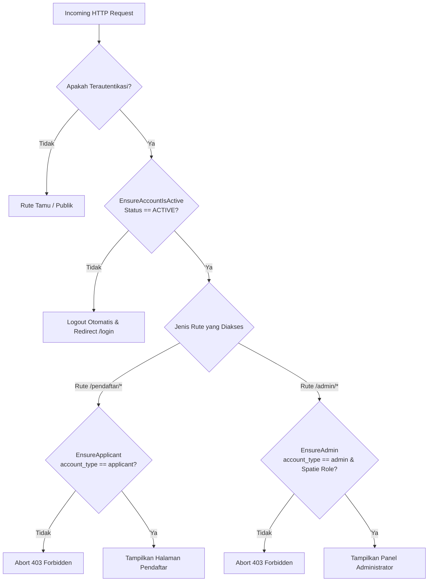
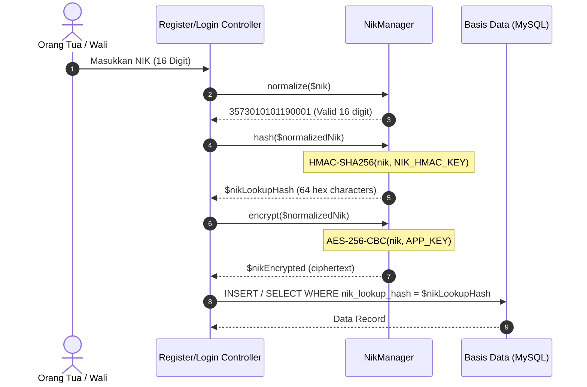
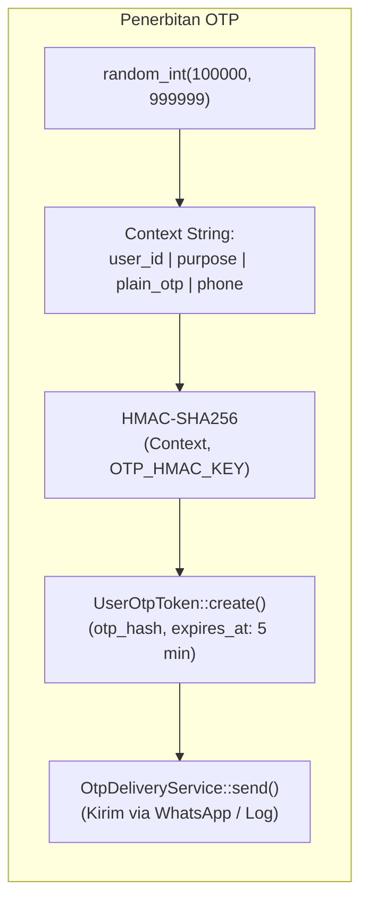

# SYSTEM ARCHITECTURE — PPDB MINSATAMA
## Dokumen Arsitektur Teknis Sistem Informasi PPDB MIN 1 Kota Madiun

---

## 1. IKHTISAR ARSITEKTUR (ARCHITECTURAL OVERVIEW)

Sistem Informasi PPDB Minsatama dibangun menggunakan pola arsitektur **Clean MVC Monolith** yang dipadukan dengan **Service / Action Pattern** pada Laravel 13.x. Desain ini memisahkan secara tegas antara lapisan presentasi (Blade), penanganan request HTTP (Routing & Form Requests), orkestrasi logika bisnis (Actions & Services), persistensi data (Eloquent ORM & Migrations), dan lapisan keamanan (Policies & Middleware).

```
+---------------------------------------------------------------------------------------+
|                                LAPISAN KLIEN / BROWSER                                |
|        Blade Templates + Tailwind CSS v4 + Vanilla JS (No SPA Framework)              |
+---------------------------------------------------------------------------------------+
                                           | HTTP Requests / Forms
                                           v
+---------------------------------------------------------------------------------------+
|                             ROUTING & MIDDLEWARE LAYER                                |
|  - routes/web.php & routes/auth.php                                                   |
|  - Middleware: EnsureAccountIsActive, EnsureApplicant, EnsureAdmin, Spatie Role       |
+---------------------------------------------------------------------------------------+
                                           | Validated Request
                                           v
+---------------------------------------------------------------------------------------+
|                             FORM REQUEST VALIDATION LAYER                             |
|  - ApplicantRegisterRequest, ApplicantLoginRequest, AdminLoginRequest, VerifyOtp...   |
+---------------------------------------------------------------------------------------+
                                           | Validated Data
                                           v
+---------------------------------------------------------------------------------------+
|                              CONTROLLER LAYER (THIN)                                  |
|  - Mengatur alur HTTP, memanggil Action/Service, mengembalikan Redirect / View        |
+---------------------------------------------------------------------------------------+
                                           | Delegasi Eksekusi
                                           v
+---------------------------------------------------------------------------------------+
|                           LOGIKA BISNIS: ACTION & SERVICE                             |
|  - Actions: RegisterApplicant, VerifyOtp, CompleteActivation, ResetPassword...        |
|  - Services: NikAuthService, OtpService, AdminAuthenticationService, NikManager       |
+---------------------------------------------------------------------------------------+
                                           | DB Transaction / Query
                                           v
+---------------------------------------------------------------------------------------+
|                         PERSISTENSI & MODEL ELOQUENT (16 MODEL)                       |
|  - User, Applicant, Registration, AdmissionPeriod, DocumentRequirement, OtpToken...   |
+---------------------------------------------------------------------------------------+
                                           | SQL Statements
                                           v
+---------------------------------------------------------------------------------------+
|                                BASIS DATA / STORAGE                                   |
|  - MySQL 8.x (InnoDB, UTF8MB4) Target Produksi / SQLite In-Memory (Test Suite)       |
|  - Private Local Storage (Dokumen Berkas & Dokumen PDF)                               |
+---------------------------------------------------------------------------------------+
```

---

## 2. STRUKTUR DIREKTORI LARAVEL

```
app/
├── Actions/
│   └── Authentication/           # Eksekusi logika bisnis atomik autentikasi
│       ├── CompleteApplicantActivationAction.php
│       ├── RegisterApplicantAction.php
│       ├── ResetPasswordAction.php
│       └── VerifyOtpAction.php
├── Contracts/                    # Antarmuka abstraksi
│   └── OtpDeliveryInterface.php
├── Enums/                        # Status dan tipe data baku (PHP 8.1+ Enums)
│   ├── AccountStatus.php
│   ├── AccountType.php
│   ├── AdmissionPeriodStatus.php
│   ├── Gender.php
│   ├── GuardianRelationship.php
│   ├── OtpPurpose.php
│   ├── PdfDocumentType.php
│   ├── PreviousEducationLevel.php
│   └── RegistrationStatus.php
├── Http/
│   ├── Controllers/
│   │   ├── Applicant/            # Kontroler area pendaftar
│   │   │   └── DashboardController.php
│   │   └── Auth/                 # Kontroler autentikasi terisolasi
│   │       ├── AdminLoginController.php
│   │       ├── ApplicantActivationController.php
│   │       ├── ApplicantLoginController.php
│   │       ├── ApplicantPasswordResetController.php
│   │       ├── ApplicantRegisterController.php
│   │       └── LogoutController.php
│   ├── Middleware/               # Penjaga otorisasi & status akun
│   │   ├── EnsureAccountIsActive.php
│   │   ├── EnsureAdmin.php
│   │   └── EnsureApplicant.php
│   └── Requests/Auth/            # Validasi form request dengan pesan Indonesia
│       ├── AdminLoginRequest.php
│       ├── ApplicantLoginRequest.php
│       ├── ApplicantRegisterRequest.php
│       ├── CompleteActivationRequest.php
│       ├── ForgotPasswordRequest.php
│       ├── ResetPasswordRequest.php
│       ├── SendOtpRequest.php
│       └── VerifyOtpRequest.php
├── Models/                       # Model Eloquent dengan relasi, casting, & hidden
│   ├── AdmissionPeriod.php
│   ├── AdmissionPeriodProgram.php
│   ├── Applicant.php
│   ├── ApplicantAddress.php
│   ├── ApplicantEducation.php
│   ├── ApplicantGuardian.php
│   ├── DocumentRequirement.php
│   ├── Program.php
│   ├── Registration.php
│   ├── RegistrationConsent.php
│   ├── RegistrationDocument.php
│   ├── RegistrationDocumentRevision.php
│   ├── RegistrationLog.php
│   ├── RegistrationPdfVersion.php
│   ├── User.php
│   └── UserOtpToken.php
├── Services/
│   └── Authentication/           # Layanan domain autentikasi & OTP
│       ├── Delivery/             # Driver pengiriman OTP
│       │   ├── ArrayOtpDelivery.php
│       │   ├── LogOtpDelivery.php
│       │   └── NullOtpDelivery.php
│       ├── AdminAuthenticationService.php
│       ├── NikAuthService.php
│       ├── OtpDeliveryService.php
│       └── OtpService.php
└── Support/
    └── NikManager.php            # Kriptografi NIK (Normalisasi, Hash HMAC, Enkripsi)
```

---

## 3. ARSITEKTUR AUTENTIKASI & OTORISASI

### 3.1 Konsep Single Guard & Multi Account Type
Sistem menggunakan satu tabel `users` dan satu guard bawaan Laravel `web`. Pembedaan tipe akses dilakukan melalui kolom `account_type`:



### 3.2 Spatie Laravel Permission
- Digunakan secara eksklusif untuk aktor administratif (`account_type = admin`).
- Guard yang digunakan: `web`.
- Peran default:
  1. `superadmin`: Memiliki semua izin termasuk konfigurasi periode, master dokumen, dan audit log.
  2. `admin_ppdb`: Memiliki izin melihat pendaftar, memvalidasi berkas fisik, dan mengekspor laporan.
- Calon siswa **tidak pernah diberikan peran Spatie** apapun untuk mencegah eskalasi hak akses (*privilege escalation*).

---

## 4. ALUR DATA & KRIPTOGRAFI DATA SENSITIF (DATA FLOW)

### 4.1 Penyimpanan dan Pencarian NIK



Keunggulan Arsitektur:
1. **Pencarian Cepat $O(1)$**: Indeks unik pada `nik_lookup_hash` memungkinkan query `WHERE` berkecepatan tinggi tanpa membaca atau mendekripsi seluruh baris database.
2. **Kerahasiaan Tingkat Tinggi**: Jika database bocor, penyerang tidak dapat mendekripsi NIK tanpa `APP_KEY`, dan tidak dapat merekonstruksi plaintext NIK dari hash tanpa `NIK_HMAC_KEY`.
3. **Penyembunyian Otomatis**: Properti `$hidden = ['password', 'remember_token', 'nik_encrypted', 'nik_lookup_hash']` pada model `User` menjamin data kriptografi sensitif tidak akan bocor ke serialisasi JSON atau API.

---

## 5. ARSITEKTUR KEAMANAN ONE-TIME PASSWORD (OTP)



### Pencegahan Race Condition & Concurrent Replay:
Pada saat verifikasi kode, sistem membuka transaksi database dengan `lockForUpdate()`:
```php
DB::transaction(function () use ($user, $purpose, $plainOtp) {
    $token = UserOtpToken::where('user_id', $user->id)
        ->where('purpose', $purpose)
        ->latest('id')
        ->lockForUpdate()
        ->first();
    // Validasi token, increment attempts, hash_equals, stempel verified_at
});
```
Metode ini menjamin tidak ada dua thread atau request konkuren yang dapat memvalidasi token yang sama secara paralel.

---

## 6. ARSITEKTUR PENYIMPANAN BERKAS (FILE STORAGE)

- **Penyimpanan Privat**: Seluruh berkas pendaftaran calon siswa (Akta Kelahiran, KK, Foto, Piagam) disimpan di dalam direktori privat `storage/app/private/ppdb/documents/`.
- **Tidak Ada Symlink Publik**: Direktori penyimpanan privat **tidak di-symlink** ke direktori `public/`.
- **Pengunduhan Terotorisasi**: File hanya dapat diakses melalui rute kontroler bertanda tangan (*signed route*) atau kontroler dengan verifikasi middleware kepemilikan dokumen (pendaftar pemilik atau panitia PPDB).
- **Integritas Versi**: Penggantian berkas tidak menghapus riwayat sebelumnya; berkas lama diarsipkan ke tabel `registration_document_revisions`.

---

## 7. ARSITEKTUR DOKUMEN PDF (PDF GENERATION)

- **Penerbitan Bertahap**:
  - `Draft PDF`: Memuat watermark transparan berukuran besar "DRAFT - BUKAN BUKTI RESMI". Dapat diunduh selama pengisian formulir.
  - `Final PDF`: Diterbitkan setelah pendaftar melakukan pengiriman final (`status = SUBMITTED`). Memuat nomor registrasi unik, kode QR validasi, biodata lengkap, dan tanda tangan wali.
- **Pencatatan Versi Dokumen**:
  Setiap generasi PDF dicatat pada tabel `registration_pdf_versions` mencakup `file_path`, `version_number`, `document_type`, dan `generated_at`.
- **Invalidasi Status**:
  Jika pendaftar mengubah data setelah pendaftaran final diajukan (selama masa pendaftaran masih dibuka), versi PDF lama ditandai usang (*outdated*) dan versi baru diterbitkan dengan penomoran berurutan.
