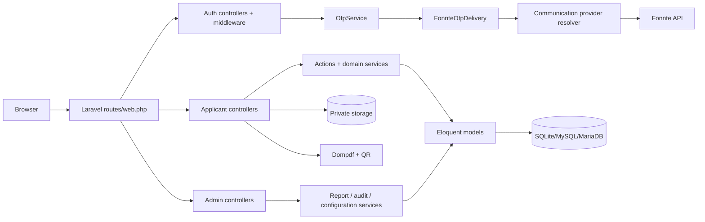
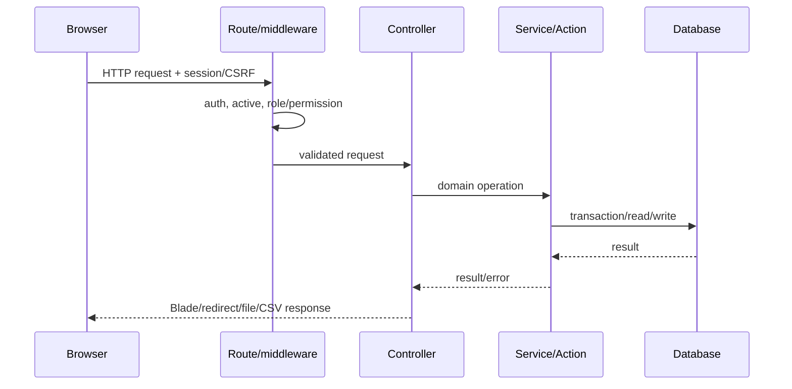
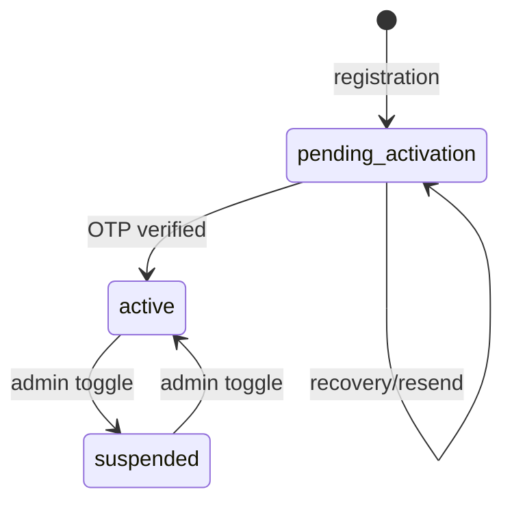
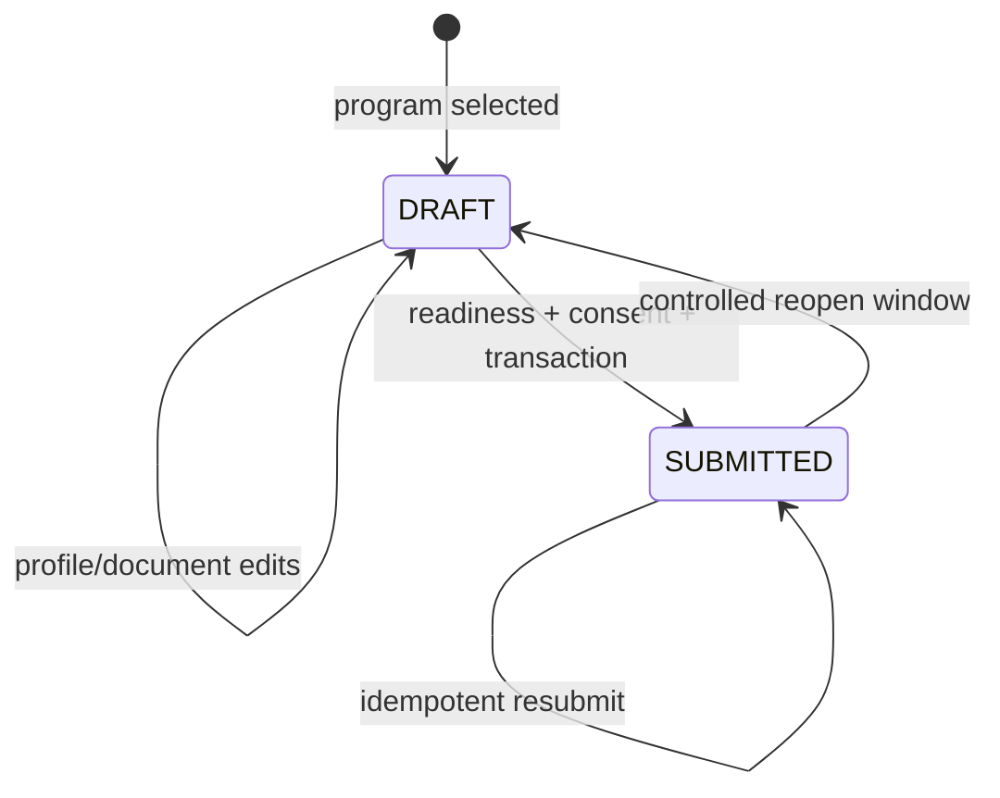
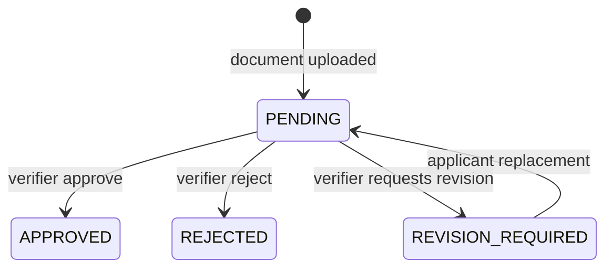
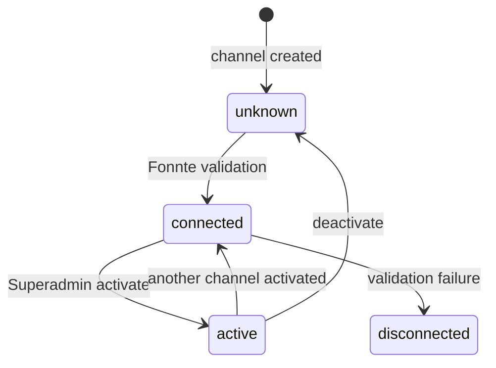
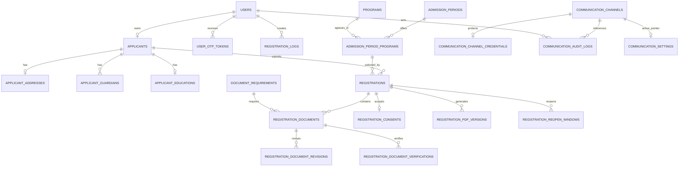
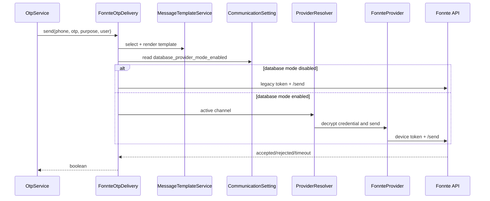
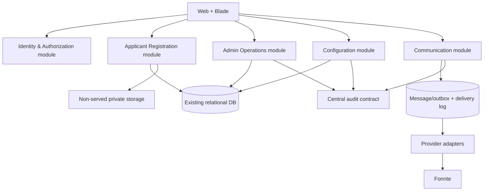

# Full Project Review — PPDB Minsatama

Tanggal audit: 23 November 2026
Repository: `AhmadDFN/PPDB_Minsa_2026`
Branch: `main`
HEAD: `811147acd641fe523b4b846b32b89e3b4a8d36c6`

> Audit ini read-only. Kesimpulan mengikuti source code, route, migration, test, dan konfigurasi aktual checkout ini. Tidak ada migration production, deployment, pengiriman Fonnte, commit, atau push yang dilakukan selama audit.

## A. Executive Summary

Sistem telah melampaui prototype dan secara lokal merupakan **functional MVP / production candidate terbatas**: registrasi applicant, OTP, pengisian profil, dokumen privat, submit final, PDF/QR, dashboard admin, verifikasi dokumen, laporan CSV, audit viewer, admin lifecycle, system settings, dan Communication Center sudah memiliki backend, UI, route, authorization, serta regression tests. Automated suite terakhir pada checkout ini: **338 passed, 16 skipped, 1.537 assertions**; MySQL concurrency tests tetap skipped bila database disposable tidak tersedia.

Status belum dapat disebut production-ready karena migration dan konfigurasi production belum diverifikasi pada checkout ini, live acceptance belum lengkap, consent/final PDF/QR dan admin acceptance masih tertunda menurut dokumen status, serta ada risiko konfigurasi file storage yang dapat mengekspos root private melalui route storage bawaan.

Rekomendasi: pertahankan Laravel sebagai modular monolith dan lakukan hardening bertahap. Rewrite total tidak dibenarkan oleh bukti saat ini.

Temuan prioritas:

1. **HIGH — private storage exposure risk:** `config/filesystems.php` mengarahkan disk `local` ke `storage/app/private` dengan `serve => true`, sementara Laravel mendaftarkan `/storage/{path}` (route list). Upload dokumen memakai `ppdb_private` pada root yang sama. Verifikasi dan matikan serving disk private sebelum go-live.
2. **HIGH — production schema/configuration not evidenced:** Communication Center, document verification, configuration audit, template editor, dan single-active-period hardening membutuhkan migration additive/constraint yang belum dibuktikan telah dijalankan di Hostinger.
3. **MEDIUM — audit/template atomicity:** update template menyimpan `communication_settings` lalu mencatat audit secara terpisah; kegagalan audit dapat meninggalkan perubahan yang tidak tercatat.
4. **MEDIUM — template completeness:** validator menolak placeholder yang tidak dikenal tetapi tidak mewajibkan placeholder kritis (`otp`, `temporary_password`, dan sebagainya), sehingga Superadmin dapat menyimpan pesan yang tidak memuat data penting.
5. **MEDIUM — documentation drift:** `docs/PROJECT_STATUS.md` dan laporan fase lama masih menyatakan beberapa fitur pending walaupun route/controller/test telah berada di `main`.

## B. Repository Baseline

| Item | Bukti aktual |
|---|---|
| Root | `D:/Min 1 Kota Madiun/Program/PPDB_MINSATAMA_2026_GIT_RECOVERY` |
| Branch | `main` |
| HEAD | `811147acd641fe523b4b846b32b89e3b4a8d36c6` |
| Remote | `https://github.com/AhmadDFN/PPDB_Minsa_2026.git` |
| Remote parity | `HEAD...origin/main = 0 0` pada awal audit |
| Working tree | Bersih; tidak ada staged, unstaged, atau untracked files |
| Last commit | `feat(admin): add editable whatsapp message templates` |

Tidak ada `.env`, credential, database SQLite, atau data applicant tracked. `.env.example` dan `.env.staging.example` hanya template. Build assets tracked dan manifest menunjuk asset CSS/JS yang ada.

## C. Project Overview

Tujuan bisnisnya adalah portal penerimaan peserta didik baru kelas 1 MIN 1 Kota Madiun untuk periode yang dikonfigurasi. Applicant memasukkan identitas, melengkapi data, memilih program, mengunggah dokumen, menyetujui pernyataan, mengirim pendaftaran, lalu memperoleh bukti PDF/QR untuk proses loket. Aplikasi tidak mengimplementasikan seleksi/ranking, kuota penerimaan, pengumuman kelulusan, atau daftar ulang; hal tersebut di luar alur yang terbukti di route/model.

Pengguna aktual:

- `applicant`: calon peserta didik/orang tua yang mengisi dan mengirim pendaftaran.
- `admin_ppdb`: operator dengan permission operasional.
- `superadmin`: administrator penuh dan satu-satunya pengelola konfigurasi sensitif.
- guest: landing, registrasi, login, aktivasi, recovery, dan verifikasi QR publik.

Aturan utama terlihat pada `config/ppdb.php`, enum `RegistrationStatus`, `AdmissionPeriodStatus`, `AccountStatus`, dan `RegistrationReadinessService`: consent dikonfigurasi melalui environment, OTP 6 digit/expiry/attempts dikonfigurasi, dokumen maksimal 5120 KB, dan registration hanya submitted setelah readiness serta consent lulus.

## D. Current Architecture

### D.1 Technology stack

| Area | Implementasi |
|---|---|
| Backend | Laravel `^13.17`, PHP `^8.3` (`composer.json`) |
| Auth | Laravel session/web guard, `User` authenticatable, password hashing cast |
| Authorization | Spatie Laravel Permission `^8.5`, middleware `admin`, `applicant`, `active`, `can:*` |
| UI | Blade components/layouts, Tailwind CSS v4, Vite v8 |
| Database | SQLite test in-memory; MySQL/MariaDB target via configured connections |
| Storage | Local private disk `ppdb_private`, public disk, optional S3 |
| PDF/QR | `barryvdh/laravel-dompdf`, `bacon/bacon-qr-code` |
| WhatsApp | Fonnte HTTP adapter; legacy env token atau database channel mode |
| Queue/cache | Laravel database/sync/redis options; default values are environment-dependent |
| Frontend | Small Vite entrypoint; domain UI is server-rendered Blade |

### D.2 Responsibility map

- Controllers coordinate HTTP, validation, authorization, redirects, and service/action calls.
- Actions own multi-step writes (`app/Actions`), while domain services own readiness, document, registration-number, PDF, activity, report, and Communication Center behavior.
- Models encapsulate relations/casts and a few safe helpers (`User`, `SystemSetting`, `Registration`).
- Form Requests validate applicant/admin filters and writes.
- Migrations are additive but history contains several successive registration-number and document-size migrations.
- Dependency injection is used in controllers/services; `FonnteOtpDelivery` still resolves `CommunicationChannelService` from the container and uses static template builders, so the integration is practical but not fully decoupled.

The architecture is a conventional modular monolith. There is no evidence of circular dependency, microservice boundary, queue job for WhatsApp, event bus, or repository layer. The main smells are duplicated/legacy registration-number generator paths (`RegistrationNumberGeneratorService::generateForPeriod` and `next`), long controllers (notably `AdminUserController`), and Blade-level navigation conditionals.

### D.3 Actual component diagram

### D.4 Request lifecycle

## E. Role & Permission Matrix

Server-side evidence comes from `routes/web.php`, `EnsureAdmin`, `EnsureApplicant`, `RoleAndPermissionSeeder`, and controller checks. Sidebar visibility is not used as proof.

| Modul | Superadmin | Admin PPDB | Applicant | Guest |
|---|---|---|---|---|
| Dashboard admin | Yes `view_dashboard` | Yes `view_dashboard` | No | No |
| Pendaftaran/profile | No applicant routes | No | Yes `applicant` + active + non-temporary | No |
| Data pendaftar | Yes | Yes `view_applicants` | No | No |
| Dokumen applicant | Own documents only | No | Own documents only | No |
| Verifikasi dokumen | Yes | Yes `verify_documents` | No | No |
| Reports/CSV | Yes | Yes `export_reports` | No | No |
| Audit Viewer | Yes | No by seeded role | No | No |
| Admin users | Yes | No by seeded role | No | No |
| Roles/permissions | Yes | No | No | No |
| Admission periods | Yes | No by seeded role | No | No |
| Programs | Yes | No by seeded role | No | No |
| Document requirements | Yes | No by seeded role | No | No |
| System settings | Yes | No | No | No |
| Communication Center | Yes, controller `hasRole('superadmin')` | No | No | No |
| QR verification | Public read-only, throttled | Public read-only | Public read-only | Yes |

The seeded `admin_ppdb` allowlist contains five operational permissions plus the dashboard; the role-management controller allows a broader eight-permission allowlist (including configuration management), so a Superadmin can intentionally expand an operator beyond the default. That is a governance decision, not an accidental privilege escalation, but it requires review when assigning permissions.

## F. Complete Business Flow

### F.1 Applicant journey

1. `/` renders landing page (`routes/web.php` closure and `resources/views/welcome.blade.php`).
2. `GET/POST /daftar` uses `ApplicantRegisterController` and `RegisterApplicantAction`; NIK is encrypted/HMAC-hashed and a pending account/applicant/registration is created or recovered.
3. OTP is generated by `OtpService`, HMAC-bound to user/purpose/phone, stored in `user_otp_tokens`, and sent through configured `OtpDeliveryService` (`FonnteOtpDelivery`, array, log, or null).
4. `GET/POST /aktivasi`, `POST /aktivasi/verifikasi` use `ApplicantActivationController`; successful verification activates the user and sends a separate temporary password.
5. `/login` authenticates NIK/password. `EnsurePasswordNotTemporary` blocks the applicant workspace until `/pendaftar/ganti-password` is completed when `must_change_password` is true.
6. `/pendaftar/biodata`, `/alamat`, `/orang-tua`, `/pendidikan`, and `/program` call form Requests plus Actions through `RegistrationEditService`; each write increments revision/audits registration changes.
7. `/pendaftar/dokumen` and upload/preview/download/revision routes use private storage, requirement scope, ownership checks, MIME/size validation, and replacement revisions.
8. `/pendaftar/pendaftaran/tinjau` evaluates `RegistrationReadinessService`; required fields, program/period, required documents, and consent are surfaced.
9. `POST /pendaftar/pendaftaran/kirim` executes `SubmitRegistrationAction` in a transaction, locks registration/period/program, validates readiness and configured consent, assigns a yearly `YYNNN` number, writes consent/status/log.
10. PDF draft/final routes call `GenerateRegistrationPdfAction`; versions are hashed and stored privately. Applicant downloads only owned versions.
11. `/verifikasi/bukti-pendaftaran/{token}` performs public token + registration-number verification, throttled at 10/minute, and renders a minimal verification view.

The flow is implemented and strongly tested locally. It is not live-verified end-to-end on production in this audit. The README and historical phase documents contain stale claims about number formats and pending modules; source code is authoritative.

### F.2 Admin journey

Admin login is `/admin/login`; `EnsureAdmin` requires account type `admin` and role `superadmin` or `admin_ppdb`. `/admin/dashboard` is real and data-backed. Applicant listing/detail and private document preview/download are real. Document verification, reopen workflow, reports/CSV, and audit viewer are real routes with permission middleware. System settings and admin-user/role modules are real but Superadmin-only by seeded permissions. Communication Center is real but intentionally Superadmin-only. Placeholder fallback `/admin/{module}` redirects to dashboard and can mask missing route names; it is not a feature implementation.

### F.3 Superadmin journey

Superadmin uses the same `/admin/dashboard` workspace and gains all seeded permissions. It can manage periods, programs, document requirements, users/roles, system branding, Communication Center channels/templates, reports, document verification, reopen windows, and audit viewer. No second guard, impersonation, or separate workspace exists in current routes.

### F.4 State machines

Message templates have no explicit version/state machine. They are nullable text columns on the singleton settings row; empty values use defaults, and update is a single overwrite.

## G. Database & ERD

### G.1 Migration inventory

| Group | Tables/changes | Assessment |
|---|---|---|
| Laravel base | users, password_reset_tokens, sessions, cache, jobs | Standard framework tables |
| Permission | Spatie roles, permissions, model_has_*, role_has_permissions | Used by middleware/Gates |
| Applicant core | users PPDB fields; admission_periods; programs; admission_period_programs; applicants; addresses; guardians; educations | Relational core, foreign keys present |
| Registration | registrations; registration_sequences/yearly_registration_sequences; consents; logs; reopen_windows | Transactional workflow and audit trail |
| Documents | requirements; registration_documents; revisions; verification workflow | Private files + history; additive verification migration |
| PDF/OTP | registration_pdf_versions; user_otp_tokens | Hash/integrity and one-time OTP storage |
| Branding | system_settings; system_setting_logs | Singleton-like key/value settings + audit |
| Admin config | admin_configuration_audit_logs | Before/after JSON audit |
| Communication | channels; encrypted credentials; singleton settings; audit logs; four template columns | Additive provider foundation |

The repository contains 37 migration files. `2026_11_24_120000_enforce_single_active_admission_period.php` is dated after the audit date and must be verified in deployment ordering. No destructive migration was run.

### G.2 ERD (actual major relations)

SQLite is the default automated-test engine. MySQL/MariaDB concurrency harnesses exist but skip unless dedicated environment flags/connection are available. This is not equivalent to production concurrency proof. The generated schema includes several legacy sequence tables and both `generateForPeriod` and legacy `next`; consolidation should be planned before further changes.

## H. Feature Inventory

| Module | Backend | UI | DB | Authorization | Tests | Status |
|---|---|---|---|---|---|---|
| Landing | Yes | Yes | N/A | Guest | Foundation/UI tests | IMPLEMENTED AND VERIFIED |
| Registration + OTP | Yes | Yes | users/applicants/OTP | Guest + OTP | Auth suites | IMPLEMENTED AND VERIFIED |
| Activation/password lifecycle | Yes | Yes | users/tokens | Guest/applicant | Auth/hotfix suites | IMPLEMENTED AND VERIFIED |
| Applicant profile/forms | Yes | Yes | profile tables | Applicant | Applicant suites | IMPLEMENTED AND VERIFIED |
| Program selection | Yes | Yes | period/program pivot | Applicant + active period | Applicant suite | IMPLEMENTED AND VERIFIED |
| Documents/completeness | Yes | Yes | requirements/docs/revisions | Applicant ownership | Document suites | IMPLEMENTED AND VERIFIED |
| Final submission/consent | Yes | Yes | registrations/consents/logs | Applicant | Workflow/E2E | IMPLEMENTED BUT PARTIALLY VERIFIED (live pending) |
| PDF/QR | Yes | Yes/public verify | PDF versions | Ownership/public token | PDF suites | IMPLEMENTED BUT PARTIALLY VERIFIED (live pending) |
| Admin dashboard/applicants | Yes | Yes | Aggregates | `view_*` | Admin suites | IMPLEMENTED AND VERIFIED |
| Document verification | Yes | Yes | verification logs | `verify_documents` | Verification suite | IMPLEMENTED AND VERIFIED |
| Reopen registration | Yes | Yes | reopen windows/logs | `reopen_registration` | Reopen suite | IMPLEMENTED AND VERIFIED |
| Reports/CSV | Yes | Yes | joins/counts | `export_reports` | Export suite | IMPLEMENTED AND VERIFIED |
| Audit Viewer | Yes | Yes | multiple audit sources | `view_activity_logs` | Audit suite | IMPLEMENTED AND VERIFIED |
| Admin users/roles | Yes | Yes | users + Spatie | `manage_admin_users` | Access suite | IMPLEMENTED AND VERIFIED |
| System settings | Yes | Yes | settings/logs | `manage_system_settings` | Hotfix suite | IMPLEMENTED BUT PARTIALLY VERIFIED (live migration pending) |
| Communication provider | Yes | Yes | channel/credential/settings/audit | Superadmin controller check | Communication suite | IMPLEMENTED BUT PARTIALLY VERIFIED |
| WhatsApp templates | Yes | Yes | settings text columns | Superadmin controller check | Communication suite | IMPLEMENTED AND VERIFIED locally |
| Notification rules/message logs | No | No | No | N/A | None | NOT IMPLEMENTED |
| Infrastructure monitoring | No | Placeholder only | N/A | N/A | None | NOT IMPLEMENTED |

## I. Communication Center Review

Actual components: `WhatsAppProviderInterface`, `WhatsAppProviderRegistry`, `WhatsAppProviderResolver`, `FonnteProvider`, `CommunicationChannelService`, credential service, connection service, audit service, four Eloquent models, `CommunicationChannelController`, `FonnteOtpDelivery`, template service, migration, Blade editor, and focused tests.

Legacy mode uses `services.fonnte.token` and fixed `/send`; database mode resolves the active channel, decrypts `credential_ciphertext` with Laravel `Crypt`, and fails closed when no active channel/credential exists. There is no silent fallback after database mode is enabled and no automatic failover. OTP activation/recovery and temporary-password/resend messages share the same delivery abstraction. Template values are stored in singleton `communication_settings`, rendered with allowlisted placeholders, and default when null.

Not implemented: notification rules, durable message logs/delivery status, retries, provider switching history/versioned templates, retention policy, controlled test recipient, broadcasts, or additional providers. No real Fonnte request was sent during audit.

## J. Security & Privacy Audit

### Positive controls

- NIK encrypted at rest and deterministic HMAC lookup (`app/Support/NikManager.php`); NIK fields hidden on `User`.
- OTP HMAC binds user/purpose/plain OTP/phone, expires, limits attempts, and uses row locking (`OtpService`).
- Applicant document ownership is checked by relationship; admin document access checks registration/document relationship.
- Private files are streamed with no-store/nosniff headers; PDF integrity hash is verified before download.
- CSV export escapes spreadsheet formula prefixes and consumes rate-limit quota before expensive work (`AdminReportController::export`).
- Credential ciphertext is encrypted, hidden from model output, and excluded from audit metadata.
- Admin/superadmin route permissions are server-side; applicant cannot use admin middleware.
- Audit logs redact applicant actor names as `Pendaftar` in the Audit Viewer.

### Findings

| Priority | Location/evidence | Risk and recommendation |
|---|---|---|
| HIGH | `config/filesystems.php` local disk `root=storage/app/private`, `serve=true`; route list exposes `storage/{path}` | Private document files may be reachable through the framework storage-serving route if path is guessed. Use a non-served root for local disk, remove/disable serving, and verify with an integration test. |
| HIGH | Communication/settings, verification, admin config migrations are additive but deployment status is not evidenced | A live app with missing tables can fail or expose incomplete operations. Backup, inspect `migrate:status`, run only reviewed migrations, then acceptance-test. |
| MEDIUM | `CommunicationChannelController::updateMessageTemplates` saves settings, then calls audit service outside a transaction | An audit failure can leave a successful data change without an audit record. Wrap update + audit in one transaction or define a deliberate compensating strategy. |
| MEDIUM | Template validation checks unknown placeholders but not required placeholders; spaces are accepted by regex but not replaced by `strtr` | A Superadmin can save a template that omits OTP/password or leaves `{{ otp }}` unresolved. Require per-template placeholders and normalize/validate exact syntax. |
| MEDIUM | `AdminUserController` sends invitation/reset notifications synchronously after account transaction | External mail failure leaves account created but invitation pending; this is documented, but operational retry/queue/visibility should be explicit. |
| MEDIUM | `local`/`ppdb_private` share `storage/app/private` root while local serving is enabled | Even if application ownership checks are correct, web-server storage route can bypass them. Separate roots and add deployment verification. |
| LOW | Historical docs still claim Communication Center/audit/report phases pending and old registration formats | Operators may follow an incorrect runbook. Reconcile status docs before UAT. |
| LOW | Legacy and current registration-number generation paths coexist | Future changes may call the wrong sequence table/format. Remove or isolate legacy path after data compatibility review. |

No evidence of SQL injection in reviewed query construction, plaintext credentials in tracked files, impersonation, or applicant IDOR in tested paths. This is a source audit, not penetration testing.

## K. Infrastructure & Integration

- Fonnte API is configured in `config/services.php`; credentials come from environment or encrypted database channel. Automated tests use `Http::fake`; no live send was performed.
- MySQL 8 CI workflow provisions disposable MySQL and runs Communication Center/registration concurrency suites, but workflow runs are not evidenced for this HEAD in the repository.
- Queue defaults to environment-driven database; no application job dispatches OTP/WhatsApp or admin email, so production delivery is synchronous.
- Cache defaults to environment-driven database; rate limiter atomicity therefore depends on a correctly configured shared cache store in production.
- Private file storage requires server filesystem permissions and must not be exposed by public links.
- Dompdf/QR generation is synchronous and can be CPU/memory intensive for concurrent users.
- GitHub Actions contains CI-only placeholder secrets, not production credentials. Hostinger auto-deploy is external operational state and was not verified in this audit.

## L. Test & Quality Review

Executed against isolated test configuration without external messaging:

| Gate | Result |
|---|---|
| Full `php artisan test --compact` | **338 passed, 16 skipped, 1.537 assertions** |
| Communication Center focused | Passed (including template authorization/rendering) |
| Fonnte delivery suite | 20 passed, 41 assertions |
| Pint `--test` | PASS |
| Composer audit | 0 advisories |
| npm audit `--omit=dev` | 0 vulnerabilities |
| `php artisan route:list` | 112 routes listed |
| `git diff --check` | PASS |

Test coverage is broad feature coverage, not measured line/branch coverage; no percentage claim is made. MySQL/MariaDB concurrency tests are conditional/skipped locally without disposable database variables. There is no production live test evidence in this audit.

Coverage gaps: storage-route exposure, real MySQL deadlock/retry behavior for all modules, real Fonnte delivery ambiguity/retry, queued mail delivery, production-sized PDF/CSV benchmarks, backup/restore, and complete live UAT.

## M. Technical Debt

1. Reconcile status/roadmap and phase reports with `main`.
2. Consolidate the two registration sequence approaches and remove dead legacy API after compatibility review.
3. Extract long admin controllers into application services/commands and transaction policies.
4. Centralize authorization policy for Communication Center instead of mixing route permission and `hasRole` checks.
5. Add an explicit audit transaction abstraction for settings/templates/configuration.
6. Add queue/outbox or delivery-log design before implementing retries/broadcasts.
7. Add tests for the public storage route and filesystem root separation.
8. Add database migration readiness checks to deployment workflow.

## N. UX & Business Process Review

The five-step applicant form and readiness summary are coherent, and messages identify missing sections. The temporary-password gate is explicit. Admin navigation now exposes real modules, but the wildcard admin fallback can redirect unknown module URLs instead of returning a clear 404. Superadmin configuration screens carry high-impact actions (provider activation, template editing) but lack preview/version history and a dry-run recipient. Applicants cannot see delivery status beyond a generic success/failure message; Fonnte timeout is correctly treated as ambiguous but has no delivery-status reconciliation.

## O. Maturity Assessment

| Dimension | Score | Evidence/reason |
|---|---:|---|
| Architecture | 3/5 | Coherent Laravel monolith, some legacy duplication |
| Code quality | 3/5 | Pint/tests strong; controllers and compatibility paths remain large |
| Database design | 3/5 | Normalized relations and constraints; migration/deployment drift risk |
| Authentication | 4/5 | OTP binding, expiry, password lifecycle covered by tests |
| Authorization | 4/5 | Server-side permission matrix and role protections |
| Applicant workflow | 4/5 | End-to-end local path implemented; production UAT pending |
| Admin workflow | 4/5 | Real operational modules and tests |
| Superadmin workflow | 3/5 | Broad control surface; live migration/operational verification pending |
| Communication Center | 3/5 | Provider/credential/templates implemented; no delivery log/retry/versioning |
| Security/privacy | 3/5 | Strong application controls, storage-serving risk must be closed |
| Testing | 4/5 | 338 tests and CI harness; conditional MySQL/live gaps |
| Documentation | 2/5 | Extensive but stale/conflicting status claims |
| Deployment readiness | 2/5 | Migration/live acceptance/backup evidence incomplete |
| Maintainability | 3/5 | Conventional structure with emerging module boundaries |
| Scalability | 2/5 | Synchronous external I/O/PDF and limited queue/observability |

Overall classification: **Functional MVP / production candidate, not Production Ready**.

## P. Major Overhaul Recommendation

| Option | Benefit | Risk/cost | Assessment |
|---|---|---|---|
| A — Maintain | Lowest disruption; preserves data and tests | Debt and cross-module coupling remain | Suitable only for urgent bug/security fixes |
| B — Modular monolith refactoring | Clear domains/contracts while retaining one deployment/database; incremental | Requires boundaries, regression tests, migration discipline | **Recommended** |
| C — Major redesign/rewrite | Clean slate and possible future scale | Highest data migration, UAT, operational and regression risk; no evidence requires rewrite | Not justified now |

Adopt B in phases: first storage/security/deployment hardening, then consolidate registration/configuration boundaries, then introduce Communication delivery/outbox only when operational requirements justify it. Keep existing tables and IDs; use additive migrations and compatibility adapters.

## Q. Proposed Target Architecture (PROPOSED)

This is proposed, not current implementation. Boundaries should be PHP namespaces/modules inside one Laravel deployment: Identity, Applicant, Registration, Documents, Admin Operations, Configuration, Communication, Reporting, and Audit. Each module owns its writes and exposes application services/contracts. Authorization remains centralized in policies/permissions. External messages should eventually use an outbox/queued delivery record with idempotency and status, but not before the current synchronous behavior is documented and tested.

## R. Prioritized Roadmap

| ID | Priority/task | Dependency | Complexity | DB impact | Acceptance criteria |
|---|---|---|---|---|---|
| P0-01 | Close private storage exposure | None | M | None/config | `/storage/.../ppdb` cannot read private docs; ownership tests still pass |
| P0-02 | Production migration/backup gate | P0-01 | M | Additive reviewed migrations | Backup, migration status, rollback plan, and post-migration smoke test recorded |
| P0-03 | Live applicant/admin acceptance | P0-02 | M | Test data only | Consent, submit, PDF/QR, permissions and cleanup verified on approved test accounts |
| P1-01 | Reconcile documentation/status | P0-03 | S | None | Status distinguishes implemented/tested/deployed/live-verified |
| P1-02 | Atomic template/config audit | P1-01 | M | Possibly audit metadata | Failed audit rolls back update; required placeholders enforced |
| P1-03 | Run disposable MySQL concurrency CI | P0-02 | M | Disposable only | CI records MySQL 8/MariaDB results; no production tables used |
| P1-04 | Centralize authorization policy | P1-01 | L | None | Route/controller/sidebar matrix generated and regression-tested |
| P2-01 | Consolidate registration-number legacy path | P0-03 | M | Compatibility migration review | One generator/sequence strategy; existing numbers unchanged |
| P2-02 | Add Communication delivery log/outbox | P1-02 | L | New message tables | Idempotency, retry, status, redaction and retention tests |
| P2-03 | Improve template UX | P1-02 | M | Version/history tables optional | Preview, version history, rollback, required variables, non-production preview |
| P2-04 | Performance benchmarks | P0-03 | M | Index review | Measured dashboard/report/PDF/CSV budgets under representative data |
| P3-01 | Additional providers/broadcasts | P2-02 | XL | New provider/message model | Explicit consent, recipient controls, rate limits, audit and rollback |

## S. Final Conclusion

1. **Sampai mana?** Functional MVP/production candidate with a broad implemented applicant and admin platform; current `main` also contains Audit Viewer, Reports, Admin management, configuration, and Communication Center.
2. **Siap apa?** Local automated operation of registration, OTP, profile, document, submission, PDF/QR, admin review, reports, audit, settings, and Fonnte/template configuration.
3. **Belum layak digunakan tanpa gate?** Live production operation is not evidenced for final consent/PDF/QR, all admin/superadmin modules, migrations, storage exposure, backup/restore, and real Fonnte delivery status.
4. **Masalah terpenting?** Private storage serving risk, incomplete production migration/acceptance evidence, stale documentation, and synchronous/weakly observable external delivery.
5. **Perlu major overhaul?** No rewrite. Use a modular-monolith refactoring plan with security and deployment hardening first.
6. **Urutan rasional:** close storage risk → backup/migrate in controlled window → live acceptance and rollback evidence → reconcile docs → atomic audit/template hardening → MySQL concurrency CI → authorization/module cleanup → delivery outbox/observability.

## T. Evidence Index

Primary evidence inspected: `routes/web.php`, `composer.json`, `package.json`, `config/ppdb.php`, `config/filesystems.php`, `config/services.php`, `config/queue.php`, `app/Http/Middleware/EnsureAdmin.php`, `EnsureApplicant.php`, `app/Services/Authentication/OtpService.php`, `app/Services/Authentication/Delivery/FonnteOtpDelivery.php`, `app/Services/Communication/*`, `app/Services/Registration/*`, applicant/admin controllers and Actions, all 37 migrations, `RoleAndPermissionSeeder`, `tests/Feature/**`, `tests/Unit/**`, `.github/workflows/communication-center-mysql-validation.yml`, `docs/PROJECT_STATUS.md`, and `docs/TODO_ROADMAP.md`.
