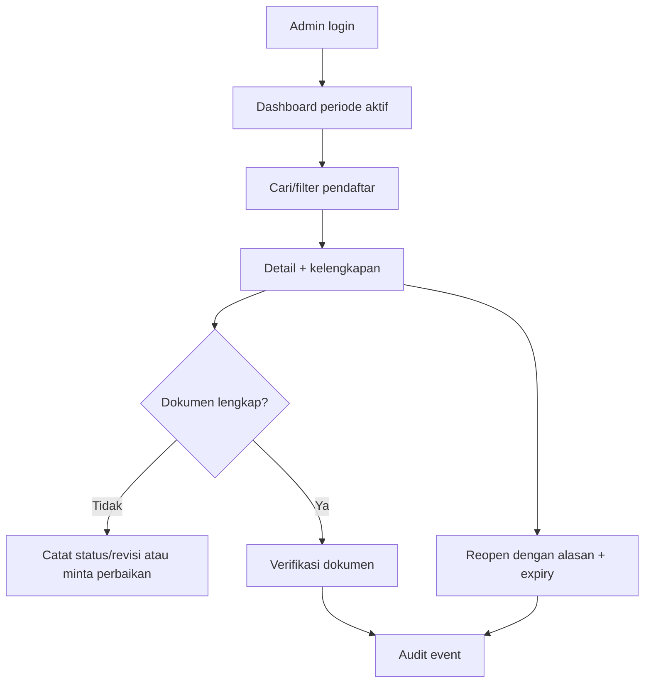

# Workflow Admin & Superadmin

## Operasi pendaftar

## Governance Superadmin

Superadmin meninjau health dan audit, mengelola periode/program/persyaratan, mengelola akun admin, menetapkan branding, dan mengekspor laporan redacted. Perubahan master data harus menyimpan before/after dan dampak periode.

## Workflow insiden

Deteksi → capture request id dan waktu WIB → klasifikasi PII/availability → containment tanpa endpoint migrasi HTTP → backup/approval → perbaikan → regression test → update audit/status → komunikasi owner.

## Invariants

Tidak ada akses lintas registration; reopen harus beralasan dan kedaluwarsa; status pendaftaran tetap `DRAFT`/`SUBMITTED`; semua aksi privileged menghasilkan audit event; operasi gagal harus fail-closed.
