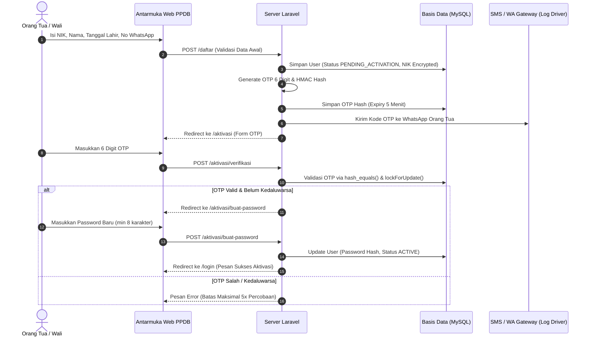

# ALUR KERJA SISTEM (COMPLETE BUSINESS WORKFLOW)
## Sistem Informasi PPDB Online MIN 1 Kota Madiun (PPDB Minsatama)
### Tahun Ajaran 2026/2027

Dokumen ini memetakan seluruh alur kerja operasional aplikasi PPDB Minsatama secara visual dan naratif menggunakan diagram Mermaid standar, memisahkan secara tegas antara **Alur Pengguna (Orang Tua)**, **Proses Internal Server**, **Alur Petugas Admin**, dan **Proses Luring di Loket PTSP Madrasah**.

---

## 1. DIAGRAM ALUR KESELURUHAN (END-TO-END FLOWCHART)

```mermaid
flowchart TD
    subgraph Pendaftar["ALUR ORANG TUA / WALI (DARING)"]
        A["1. Buka Website PPDB Minsatama"] --> B["2. Registrasi Akun (NIK + No WhatsApp)"]
        B --> C["3. Masukkan Kode OTP 6 Digit"]
        C --> D["4. Buat Kata Sandi Akun"]
        D --> E["5. Masuk (Login) via NIK + Password"]
        E --> F["6. Lengkapi 4 Modul Formulir\n(Biodata, Alamat, Ortu, TK)"]
        F --> G["7. Pilih Program (Reguler / Unggulan)"]
        G --> H["8. Unggah Berkas Wajib (KK + Pas Foto)"]
        H --> I{"9. Unduh PDF Draf?\n(Opsional Cek Format)"}
        I -- Ya --> J["Periksa PDF Draf (Watermark DRAFT)"]
        I -- Tidak --> K["10. Buka Menu Tinjau & Kirim"]
        J --> K
        K --> L["11. Setujui Pernyataan (Consent v1.0)"]
        L --> M["12. Klik Tombol Kirim Pendaftaran Final"]
    end

    subgraph Server["PROSES INTERNAL SERVER (BACKEND)"]
        M --> N["Validasi Kelengkapan Pra-Submit 100%"]
        N --> O["Kunci Urutan Sequence Transaksional\n(SELECT ... FOR UPDATE)"]
        O --> P["Terbitkan Nomor Registrasi Resmi\nPPDB/{tahun}/{program}/{urutan}"]
        P --> Q["Ubah Status Pendaftaran: SUBMITTED"]
    end

    subgraph PascaSubmit["ALUR PENCETAKAN & VERIFIKASI RESMI"]
        Q --> R["13. Unduh Bukti Registrasi Resmi (PDF Final)"]
        R --> S["14. Cetak PDF di Kertas HVS A4 & Tanda Tangan"]
        S --> T["15. Siapkan Berkas Fisik Asli & Fotokopi"]
    end

    subgraph PTSP["PROSES FISIK DI LOKET PTSP MADRASAH (LURING)"]
        T --> U["16. Datang ke Loket PTSP MIN 1 Kota Madiun"]
        U --> V["17. Petugas Pindai Kode QR via Kamera Ponsel"]
        V --> W{"18. Status QR Valid & Nomor Cocok?"}
        W -- Ya --> X["Petugas Verifikasi Berkas Fisik Asli"]
        W -- Tidak/Outdated --> Y["Minta Orang Tua Cetak Versi Terbaru"]
        X --> Z["Petugas Terbitkan Tanda Terima Fisik\n(SELESAI PELAYANAN APLIKASI)"]
    end
```



---

## 2. DIAGRAM ALUR REGISTRASI & AKTIVASI AKUN (OTP WORKFLOW)



---

## 3. DIAGRAM ALUR PERBAIKAN DATA PASCA-SUBMIT & ADMIN REOPEN

```mermaid
sequenceDiagram
    autonumber
    actor Admin as Admin PPDB Madrasah
    actor Parent as Orang Tua Calon Siswa
    participant AdminUI as Panel Admin (/admin)
    participant Server as Server PPDB
    participant AppUI as Dasbor Siswa (/pendaftar)
    participant DB as Basis Data

    Note over Parent,Admin: Periode PPDB telah ditutup; orang tua minta koreksi data
    Parent->>Admin: Datang ke loket bawa berkas fisik & minta buka akses edit
    Admin->>AdminUI: Buka /admin/registrations
    Admin->>AdminUI: Klik "Buka akses" pada pendaftaran siswa bersangkutan
    Admin->>AdminUI: Masukkan Alasan Wajib & Waktu Kedaluwarsa (misal 6 jam)
    AdminUI->>Server: POST /admin/registrations/{id}/reopen
    Server->>DB: Buat baris baru di registration_reopen_windows & catat audit log
    Server-->>AdminUI: Notifikasi Akses Berhasil Dibuka
    
    Admin-->>Parent: Beritahu orang tua bahwa form dapat diedit kembali
    Parent->>AppUI: Buka /pendaftar/dashboard (Tombol Edit Terbuka)
    Parent->>AppUI: Ubah data (misal Alamat atau Pas Foto)
    AppUI->>Server: POST Pembaruan Formulir
    Server->>DB: Update data siswa & naikkan counter data_revision (+1)
    Server->>DB: Tandai berkas PDF Final versi lama sebagai OUTDATED
    
    Parent->>AppUI: Klik Cetak Ulang PDF Versi Terbaru
    AppUI->>Server: POST /pendaftaran/pdf/final
    Server->>DB: Terbitkan versi PDF baru di registration_pdf_versions
    Server-->>Parent: Unduh PDF Final Terbaru (Nomor Registrasi Tetap Sama)
    
    opt Penutupan Dini oleh Admin
        Admin->>AdminUI: Klik "Tutup akses sekarang"
        AdminUI->>Server: POST /registration-reopen-windows/{id}/close
        Server->>DB: Tutup jendela akses seketika
    end
```
