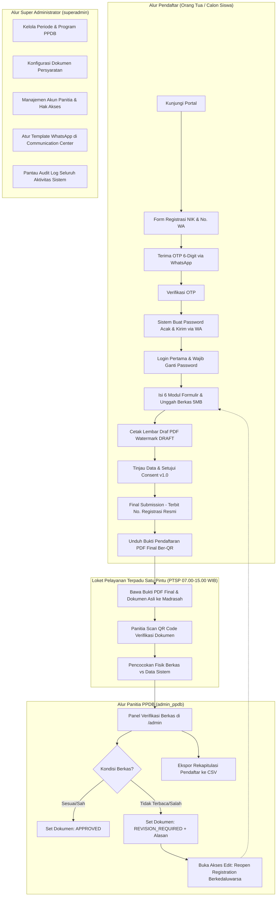

# ALUR KERJA APLIKASI PER ROLE (WORKFLOW GUIDE)
### Panduan Lengkap Tata Kelola & Alur Proses Bisnis PPDB MIN 1 Kota Madiun

Sistem PPDB Minsatama membagi hak akses dan tanggung jawab operasional ke dalam peran (*roles*) yang terisolasi dengan tegas demi menjamin keamanan data dan kelancaran pelayanan.

---

## 1. Ikhtisar Diagram Alur Antar-Peran



---

## 2. Role 1: Calon Siswa & Orang Tua / Wali Murid (*Applicant*)

Peran ini berinteraksi melalui portal publik pendaftar (`https://ahmaddanyfn.biz.id/`). Pendaftar **tidak memiliki akses** ke rute `/admin/*`.

### Tahap 1: Registrasi Akun Mandiri
1. Wali murid membuka halaman `/daftar`.
2. Mengisi data pendaftaran awal:
   - **NIK Calon Siswa** (16 digit angka, unik secara global).
   - **Nama Lengkap Calon Siswa**.
   - **Nomor WhatsApp Orang Tua/Wali** (dapat digunakan kembali untuk saudara kandung / *sibling support*).
   - **Persetujuan Registrasi Awal**.
3. Sistem membuat akun berstatus `PENDING_ACTIVATION` dan secara otomatis mengirimkan 6 digit kode OTP via WhatsApp.

### Tahap 2: Verifikasi OTP & Password Otomatis
1. Pendaftar diarahkan ke halaman `/aktivasi`.
2. Memasukkan kode OTP 6 digit (berlaku 5 menit, maksimal 5 kali percobaan).
3. Setelah OTP terverifikasi:
   - Status akun berubah menjadi `ACTIVE`.
   - Sistem secara otomatis men-generate **kata sandi acak yang aman** (10 karakter alfanumerik) dan menyimpannya secara terenkripsi (`Hash::make`).
   - Kata sandi sementara dikirimkan melalui pesan WhatsApp terpisah ke nomor terdaftar.
   - Kolom `must_change_password` ditandai `true`.

### Tahap 3: Login & Pembaruan Sandi Wajib
1. Pendaftar masuk di `/login` dengan NIK calon siswa dan kata sandi sementara.
2. Karena `must_change_password = true`, sistem langsung mengarahkan ke halaman `/pendaftar/ganti-password`.
3. Pendaftar memasukkan kata sandi saat ini dan membuat kata sandi baru pribadi.
4. Setelah sukses, pendaftar dialihkan ke **Dasbor Pendaftar** (`/pendaftar/dashboard`).

### Tahap 4: Pengisian Formulir 6 Modul Terpadu
Pendaftar melengkapi 6 modul secara bertahap (tersimpan otomatis tanpa takut kehilangan data):
1. **Biodata Siswa** (`/pendaftar/biodata`): Tempat lahir, tanggal lahir, jenis kelamin, anak ke-, jumlah saudara, dan NISN (opsional). NIK terkunci permanen.
2. **Alamat Domisili** (`/pendaftar/alamat`): Alamat jalan, RT, RW (preservasi leading zeroes), desa/kelurahan, kecamatan, kab/kota, provinsi, dan kode pos. Sistem menghitung estimasi jarak ke madrasah.
3. **Data Orang Tua & Wali** (`/pendaftar/orang-tua`): Data Ayah Kandung dan Ibu Kandung wajib diisi lengkap (Nama, NIK, Status Hidup, Pendidikan, Pekerjaan, Penghasilan, No. HP). Data Wali bersifat opsional.
4. **Riwayat Pendidikan Asal** (`/pendaftar/pendidikan`): Jenjang RA/TK/PAUD/Lainnya/Tidak Sekolah, nama sekolah, NPSN, dan lokasi.
5. **Pilihan Program Pendidikan** (`/pendaftar/program`): Memilih jalur **Program Reguler** atau **Program Unggulan**.
6. **Dokumen Persyaratan** (`/pendaftar/dokumen`): Mengunggah berkas legalitas wajib:
   - Kartu Keluarga (PDF/JPG/PNG, maks 5 MB).
   - Akta Kelahiran (PDF/JPG/PNG, maks 5 MB).
   - Pas Foto Calon Siswa ukuran 3x4 (JPG/PNG, maks 5 MB).

### Tahap 5: Lembar Draf PDF Pendaftaran
- Di dasbor, pendaftar dapat menekan tombol **"Buat PDF Draf"** kapan saja.
- Menghasilkan berkas PDF pratinjau yang dilengkapi watermark **`DRAFT`** pada setiap halaman untuk diperiksa kebenaran datanya sebelum pengiriman akhir.

### Tahap 6: Tinjauan, Persetujuan (Consent), & Final Submit
1. Pendaftar membuka halaman `/pendaftar/pendaftaran/tinjau`.
2. Sistem melakukan validasi kesiapan (*readiness check*) terhadap 9 kriteria kelengkapan.
3. Jika seluruh data dan dokumen wajib lengkap:
   - Tampil kotak persetujuan legalitas dengan redaksi resmi:
     > *"Saya selaku orang tua/wali menyatakan bahwa seluruh data yang diisikan adalah benar dan dapat dipertanggungjawabkan."*
   - Versi persetujuan tercatat sebagai `v1.0`.
4. Pendaftar mencentang persetujuan dan menekan tombol **"Kirim Pendaftaran"**.
5. Proses submit berjalan **atomik dan idempoten**:
   - Status berubah dari `DRAFT` menjadi **`SUBMITTED`**.
   - Menerbitkan **Nomor Registrasi Resmi** unik: `PPDB/{TAHUN-AJARAN}/{PROGRAM}/{URUTAN-5-DIGIT}` (contoh: `PPDB/2026-2027/UNGGULAN/00001`).
   - Menyimpan snapshot historis data pendaftar dan consent.
   - Seluruh formulir terkunci (*locked*) untuk mencegah perubahan data sepihak.

### Tahap 7: Bukti Pendaftaran PDF Final & Verifikasi QR
1. Pendaftar mengunduh **Bukti Pendaftaran Resmi** berformat PDF (kertas standar A4, layout bersih tanpa watermark DRAFT).
2. Dokumen dilengkapi **QR Code verifikasi unik** yang menunjuk ke URL publik `https://ahmaddanyfn.biz.id/verifikasi/bukti-pendaftaran/{token}`.
3. Halaman verifikasi publik membuktikan keaslian dokumen tanpa membuka data pribadi sensitif (NIK lengkap, alamat, dan nomor HP orang tua disembunyikan).

---

## 3. Role 2: Panitia PPDB / Petugas Verifikator (`admin_ppdb`)

Panitia PPDB bertugas melakukan verifikasi berkas pendaftar dan melayani orang tua siswa saat penyerahan dokumen fisik di loket PTSP madrasah.

### 1. Autentikasi & Dashboard Panitia
- Login menggunakan Email Madrasah dan Password di `/admin/login`.
- Mengakses Dasbor Operasional Panitia (`/admin/dashboard`):
  - Memantau jumlah pendaftar berstatus `SUBMITTED`.
  - Melihat grafik pendaftar per program (Reguler vs Unggulan).
  - Memantau antrean berkas yang menunggu verifikasi (*Pending Verification Queue*).

### 2. Manajemen & Pencarian Pendaftar (`/admin/pendaftar`)
- Melihat daftar pendaftar lengkap dengan filter pencarian berdasarkan Nomor Registrasi, Nama Calon Siswa, atau Program.
- Membuka halaman detail pendaftar (`/admin/pendaftar/{id}`). NIK ditampilkan dalam bentuk termasking demi kepatuhan UU PDP.

### 3. Alur Verifikasi Dokumen Persyaratan (`/admin/document-verification`)
1. Panitia membuka daftar dokumen yang diunggah pendaftar.
2. Membuka pratinjau (*preview*) dokumen privat secara aman di dalam browser.
3. Menetapkan status verifikasi untuk setiap dokumen:
   - **`APPROVED`**: Dokumen sah, jelas, dan sesuai data pendaftaran.
   - **`REVISION_REQUIRED`**: Dokumen buram, terpotong, atau salah berkas. Panitia **wajib menyertakan catatan/alasan revisi**.
   - **`REJECTED`**: Dokumen palsu atau tidak memenuhi syarat mendasar.
4. Setiap aksi verifikasi mencatat identitas panitia penilai (*actor audit trail*) dan stempel waktu.

### 4. Pembukaan Akses Perbaikan Data (*Admin Reopen Registration*)
Jika dokumen pendaftar memerlukan revisi setelah pendaftaran berstatus `SUBMITTED`:
1. Panitia membuka fitur Reopen pada data pendaftar terkait.
2. Mengisi **alasan pembukaan kembali secara wajib** dan menentukan **batas waktu kedaluwarsa** (*expires_at*, misal: 24 jam).
3. Selama jendela waktu aktif:
   - Pendaftar yang bersangkutan dapat mengunggah berkas revisi atau memperbaiki data.
   - Penggantian dokumen otomatis mereset status dokumen menjadi `PENDING` untuk diverifikasi ulang.
   - Nomor registrasi dan stempel waktu submit awal **tidak berubah**.
   - Kolom `data_revision` bertambah secara otomatis untuk menjaga integritas versi data.
4. Akses edit dapat ditutup lebih awal oleh panitia jika perbaikan telah tuntas, atau akan terkunci otomatis oleh server begitu melewati batas waktu kedaluwarsa.

### 5. Rekapitulasi & Ekspor Laporan (`/admin/reports`)
1. Panitia dapat menyaring data berdasarkan Periode PPDB, Jalur Program, Rentang Tanggal Submit, dan Status Verifikasi Dokumen.
2. Melakukan ekspor data pendaftar ke format **CSV** yang aman (*streamed response*):
   - Kolom NIK dan data sensitif disanitasi dari bahaya *CSV Formula Injection*.
   - Hanya memuat kolom-kolom yang esensial untuk kebutuhan administrasi madrasah.

---

## 4. Role 3: Super Administrator (`superadmin`)

Super Administrator memegang kendali penuh atas konfigurasi sistem, tata kelola hak akses panitia, integrasi saluran komunikasi, dan pengawasan audit.

### 1. Manajemen Akun Panitia & Otorisasi (`/admin/admin-users`)
- Membuat akun panitia PPDB baru dengan peran `admin_ppdb`.
- Mengatur kata sandi panitia, mereset password, serta mengaktifkan atau menonaktifkan akun panitia yang sudah tidak bertugas.
- Meninjau matriks izin (*roles & permissions*) berbasis Spatie.

### 2. Pengaturan Master Periode PPDB (`/admin/admission-periods`)
- Menentukan nama periode pendaftaran (contoh: *PPDB MIN 1 Kota Madiun TP 2026/2027*).
- Menetapkan tahun ajaran, tanggal buka pendaftaran, dan tanggal tutup.
- Menentukan **Tanggal Acuan Perhitungan Usia** (*age_reference_date*, misal: `2026-07-01`).
- Menegakkan aturan **Single Active Period** (hanya satu periode pendaftaran yang boleh berstatus aktif dalam satu waktu).

### 3. Pengaturan Program Pendidikan (`/admin/programs`)
- Mengelola data program (Program Reguler & Program Unggulan).
- Menentukan kuota indikatif per program dan deskripsi program untuk panduan wali murid.

### 4. Pengaturan Dokumen Persyaratan (`/admin/document-requirements`)
- Menentukan berkas yang wajib diunggah (KK, Akta, Pas Foto) atau berkas tambahan (Surat Keterangan TK, Piagam Prestasi).
- Menetapkan batas maksimum ukuran berkas (standar default sistem: **5120 KB / 5 MB**).
- Mengatur tipe MIME yang diizinkan (`application/pdf`, `image/jpeg`, `image/png`).

### 5. Pusat Komunikasi WhatsApp (*Communication Center*) (`/admin/communication`)
- Memantau status koneksi perangkat WhatsApp Gateway (Fonnte API).
- Mengelola kredensial token Fonnte dengan aman tanpa terekspos ke antarmuka umum.
- Menyesuaikan **Template Pesan WhatsApp Dinamis** untuk berbagai skenario:
  - Pesan Kode Verifikasi OTP.
  - Pesan Pengiriman Kata Sandi Sementara.
  - Notifikasi Pembaruan Status Verifikasi Dokumen.
  - Notifikasi Pembukaan Kembali Akses Edit (*Reopen Window*).

### 6. Pemantau Log Audit Aktivitas (*Audit Log Viewer*) (`/admin/audit-logs`)
- Memantau linimasa aktivitas penting seluruh pengguna:
  - Perubahan pengaturan sistem oleh Superadmin.
  - Aktivitas login dan logout panitia.
  - Riwayat verifikasi dokumen oleh panitia.
  - Percobaan akses tidak sah (*security violations*).
- Dilengkapi filter berdasarkan aktor, rentang tanggal, dan tipe modul.

### 7. Pengaturan Identitas & Branding Madrasah (`/admin/pengaturan`)
- Mengonfigurasi nama kementerian (*Kementerian Agama RI*).
- Mengonfigurasi nama madrasah (*MIN 1 Kota Madiun / MINSATAMA*).
- Mengonfigurasi alamat fisik loket PTSP madrasah.
- Mengonfigurasi teks klausul persetujuan (*consent statement*) yang tampil di halaman pendaftar.

---

## 5. Alur Pelayanan Fisik di Loket PTSP Madrasah (*Offline Desk Integration*)

Meskipun pendaftaran dilakukan secara daring (*online*), proses validasi fisik dokumen asli tetap dilakukan di madrasah sebagai jaminan keabsahan data:

```
[Orang Tua / Wali Murid]
         │
         │  1. Datang ke madrasah pada jam kerja (07.00 – 15.00 WIB)
         │  2. Membawa cetakan lembar Bukti Pendaftaran PDF Final
         │  3. Membawa dokumen fisik asli (KK Asli, Akta Asli, Pas Foto 3x4)
         ▼
[Loket Pelayanan Terpadu Satu Pintu (PTSP) MIN 1 Kota Madiun]
         │
         │  4. Petugas loket memindai QR Code pada Bukti Pendaftaran
         │     (Verifikasi instan via ponsel/scanner ke halaman verifikasi resmi)
         │  5. Panitia mencocokkan fisik berkas asli dengan data di sistem
         │  6. Panitia memberikan Tanda Terima Berkas Fisik
         ▼
[Tahap Selesai Bagi Sistem PPDB Minsatama]
         │
         ▼
[Proses Seleksi Pemetaan Bakat/Minat & Keputusan Madrasah Dilakukan Offline]
```

> [!IMPORTANT]
> Sesuai batasan blueprint proyek, tanggung jawab sistem informasi PPDB Minsatama **berakhir** saat wali murid menyerahkan berkas di loket PTSP dan data dinyatakan terverifikasi. Pengolahan kelulusan, perankingan, dan daftar ulang siswa dilakukan oleh panitia madrasah melalui mekanisme rapat internal madrasah di luar sistem ini.
